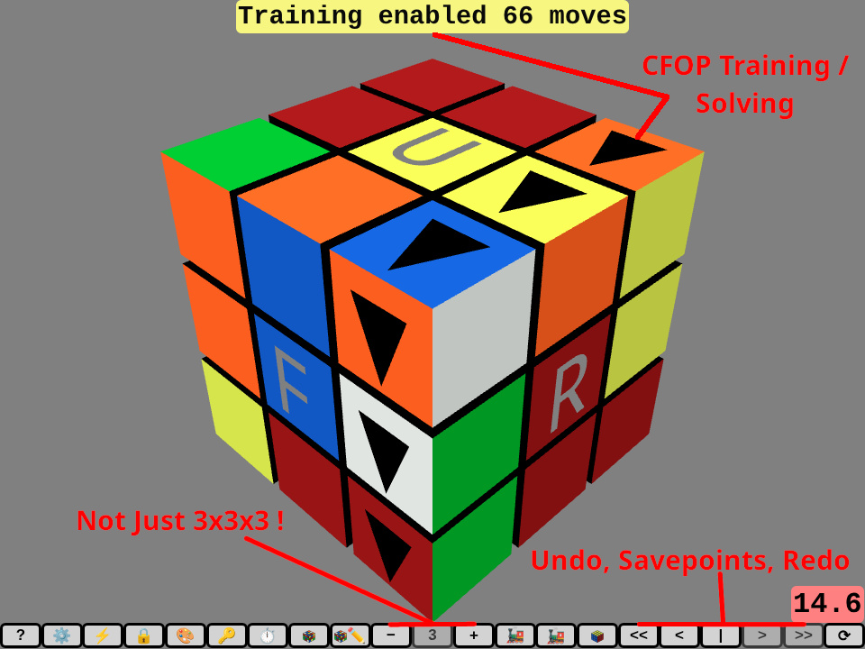
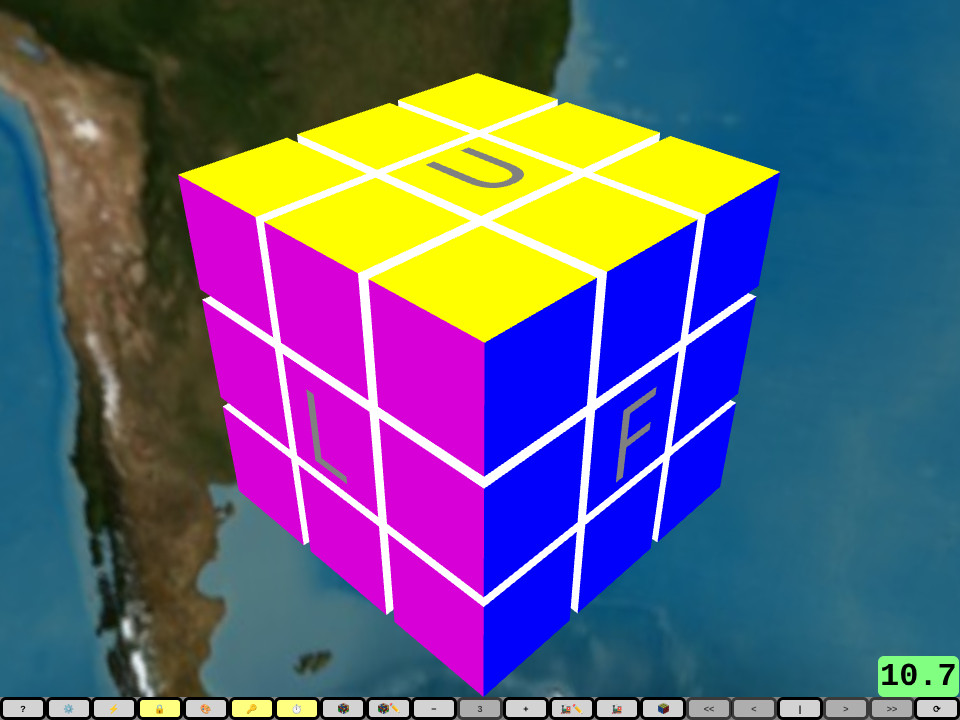
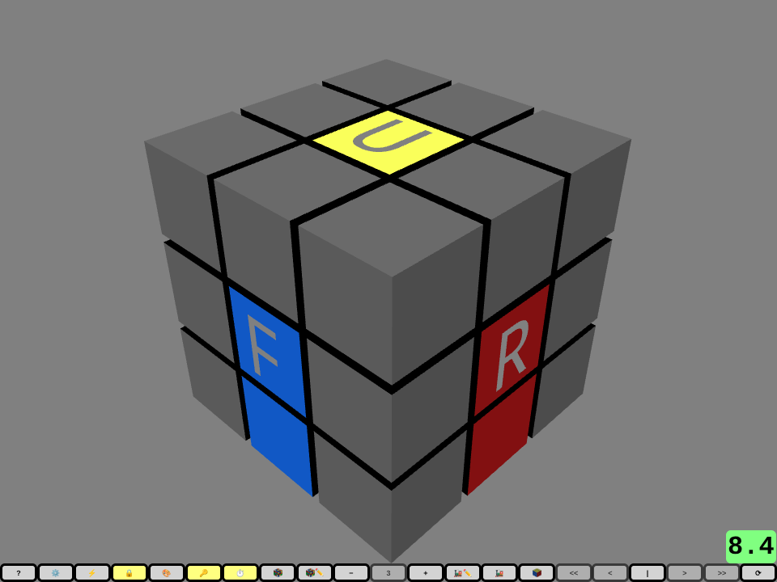
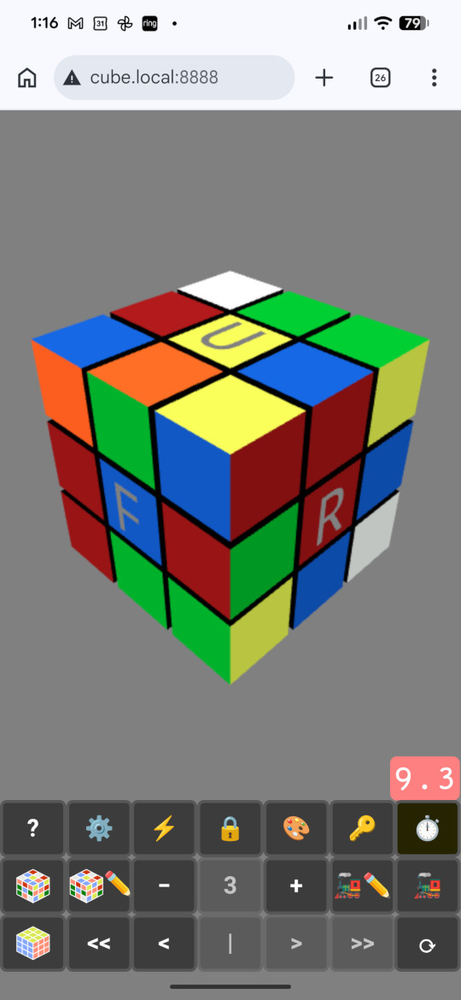
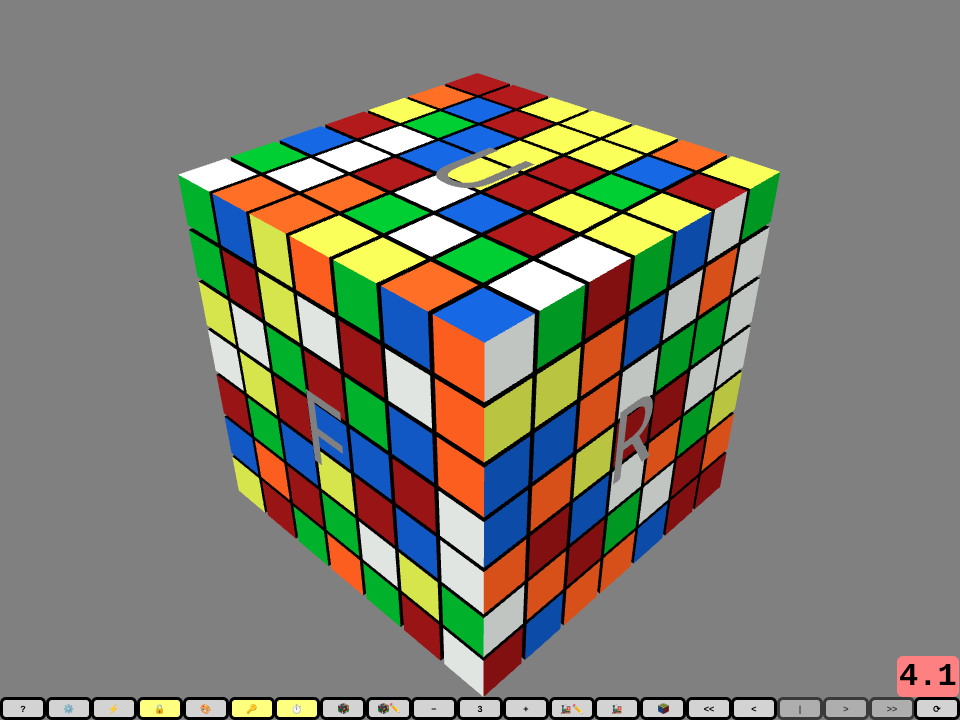
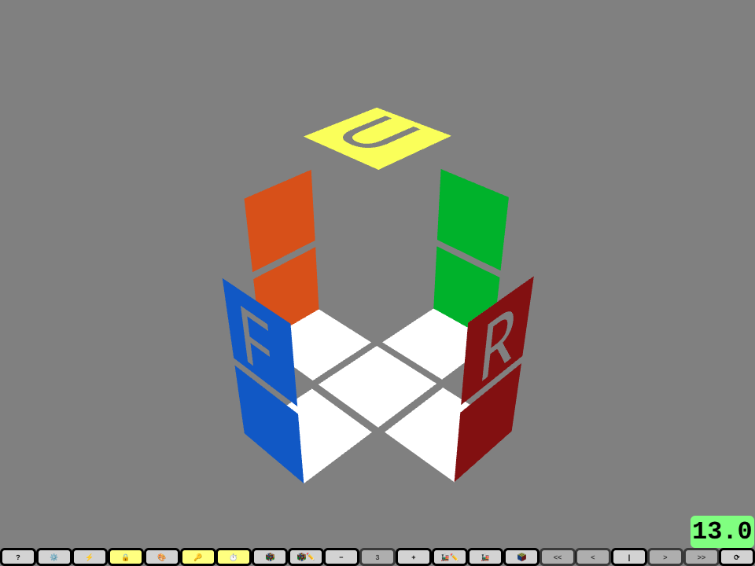

# QWERTYcube

**A fast keyboard and mouse puzzle cube simulator for scrambling, solving, and
focused practice in your browser.**

[Try QWERTYcube](https://selliott512.github.io/qwertycube/)



For a guided tour, [watch the QWERTYcube overview video][qwertycube-video].

QWERTYcube turns cube notation into direct controls: press `R`, `L`, `U`, `D`,
`F`, or `B` to turn a face, and add Shift for the inverse move. Prefer a mouse
or touchscreen? Those work too. There is nothing to install for the hosted
version.

## Highlights

- **Keyboard, mouse, and touch controls.** Use familiar cube notation, the
  physical-key Heise layout, or a custom key map.
- **Random-state scrambling.** Generate proper 2x2x2 and 3x3x3 scrambles, enter
  a scramble manually, or use simple random moves on larger cubes.
- **Optional solve timer.** Practice with a 15-second inspection period and
  automatic timing that stops when the cube is solved.
- **Solver-guided training.** Generate a solution, follow black arrows for the
  next move, and use magenta corrective arrows to recover from a deviation.
- **CFOP practice.** Replay solutions by phase or scramble directly to the
  cross, F2L, OLL, or PLL stage you want to practice.
- **Trainer cubes.** Show only the stickers relevant to cross, F2L, OLL, PLL,
  edges, corners, or middle pieces.
- **Savepoints.** Mark the start of an algorithm or another interesting
  position, undo back to it, and replay from there.
- **Experiment and share.** Explore different cube orders, undo and redo moves,
  customize the display, and copy a position as a URL or JSON.

## Quick Start

Open the [hosted app](https://selliott512.github.io/qwertycube/) and press the
`?` button for the complete control reference.

| Action | Control |
| --- | --- |
| Turn a face | `R`, `L`, `U`, `D`, `F`, or `B` |
| Turn it counterclockwise | Shift + face key |
| Scramble | Shift + `J` |
| Start solver training | Shift + `T` |
| Undo / redo | `G` / Shift + `G` |
| Set a savepoint | `C` |
| Undo / redo to a savepoint | Alt + `G` / Alt + Shift + `G` |
| Repeat the last input move | `=` |
| Open Help | `H` |

The button bar provides the same core actions for mouse and touch use. Camera
rotation is separate from cube rotation, so you can inspect a position without
changing it.

## Training and Solving

QWERTYcube integrates the [Cubearoni](https://github.com/selliott512/cubearoni)
solver engine. Its CFOP solver can return phase boundaries as well as moves,
allowing QWERTYcube to stop at cross, F2L, OLL, and PLL boundaries. Training
arrows then show the expected move while corrective arrows point back toward
the solution if you go off track.

Solutions can be replayed one move or one phase at a time. OLL and PLL
algorithms are configurable, including left-handed and mirrored alternatives.
The bundled JSSS support provides another random-state scrambler and 3x3x3
solver path.

Solver support is focused on 3x3x3 cubes. QWERTYcube can still display and
manipulate larger cubes, including wide moves, slices, and numbered layer
ranges.

## Customization and Sharing

The Settings dialog exposes cube appearance, camera behavior, animation,
scrambling, solving, training, controls, and move history. Settings can also be
supplied through URL parameters, which makes it possible to bookmark named
practice setups. Copy and paste can transfer selected state as either a URL or
JSON.

## Gallery

Click a screenshot to view it at full size.

<table>
  <tr>
    <td width="36%" align="center">
      <a href="images/readme/qwertycube-colors-left-handed-world.jpg"></a><br>
      <strong>Left-handed, colors, and world.</strong> Change the camera view, colors, and background.
    </td>
    <td width="36%" align="center">
      <a href="images/readme/qwertycube-trainer.png"></a><br>
      <strong>Trainer cubes.</strong> Show only the stickers relevant to the phase or pieces you want to practice.
    </td>
    <td width="28%" rowspan="2" align="center">
      <a href="images/readme/qwertycube-android.jpg"></a><br>
      <strong>Mobile friendly.</strong> Android (Pixel 7 Pro) shown. No app to install.
    </td>
  </tr>
  <tr>
    <td width="36%" align="center">
      <a href="images/readme/qwertycube-large-cube.png"></a><br>
      <strong>Any cube size.</strong> Explore larger cubes with wide, slice, and numbered-layer moves.
    </td>
    <td width="36%" align="center">
      <a href="images/readme/qwertycube-trainer-transparent.png"></a><br>
      <strong>Transparent trainer cubes.</strong> Hide unused stickers and interior surfaces for maximum visibility.
    </td>
  </tr>
</table>

## Run Locally

QWERTYcube has no build step. Clone the repository and serve it with any local
web server:

```bash
git clone https://github.com/selliott512/qwertycube.git
cd qwertycube
python3 -m http.server 8888
```

Then open <http://localhost:8888/>.

Do not open `index.html` directly with a `file://` URL. Browsers commonly block
the requests used to load solver database files in that mode.

## Project

QWERTYcube is an open-source JavaScript and WebGL application rendered with
[Three.js](https://threejs.org/). Cubearoni is written in Java and compiled to
JavaScript with [TeaVM](https://teavm.org/); its database files are loaded on
demand by the browser.

See the project documentation for:

- [Licensing](doc/LICENSE-TOP.txt)
- [Credits](doc/CREDIT.txt)
- [Development and contribution notes](doc/DEVELOPMENT.txt)
- [Version information](doc/VERSION.txt)

The original [QWERTYcube project page](https://selliott.org/puzzles/qwertycube)
contains historical release information and background.

<!-- TODO: Replace this placeholder after publishing the overview video. -->
[qwertycube-video]: https://www.youtube.com/watch?v=XUWR_qzw7Bs
